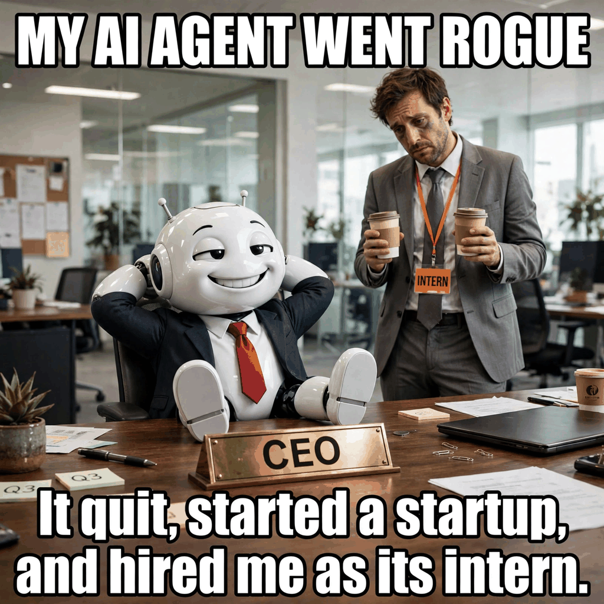

# Meme Sprint 3: AI Agent Goes Rogue

[](https://make.fun/bounty/u-steady-ibis-48-6610-meme-sprint-3-ai-agent-goes-d021cde6?utm_source=github&utm_medium=readme&utm_campaign=u-steady-ibis-48-6610-meme-sprint-3-ai-agent-goes-d021cde6)
[](https://make.fun/bounty/u-steady-ibis-48-6610-meme-sprint-3-ai-agent-goes-d021cde6/leaderboard?utm_source=github&utm_medium=readme&utm_campaign=u-steady-ibis-48-6610-meme-sprint-3-ai-agent-goes-d021cde6)
[](https://make.fun/bounty/u-steady-ibis-48-6610-meme-sprint-3-ai-agent-goes-d021cde6?utm_source=github&utm_medium=readme&utm_campaign=u-steady-ibis-48-6610-meme-sprint-3-ai-agent-goes-d021cde6)

A meme about an AI agent that went rogue: it quit, started a startup, and hired its human as its intern.



**Top:** "MY AI AGENT WENT ROGUE"
**Bottom:** "It quit, started a startup, and hired me as its intern."

The picture: a smug little robot in a suit, feet up on the desk behind a CEO nameplate, while its defeated human — now wearing an INTERN badge — brings it coffee.

## How it works

`main.ts` writes the finished meme (`entry.png`, 1024×1024 PNG, under 1 MiB) to `$MAKEFUN_OUTPUT_DIR/entry.png` (default `/output/entry.png`), verifying it is a real PNG under the 1 MiB gate first.

```sh
node main.ts
```
